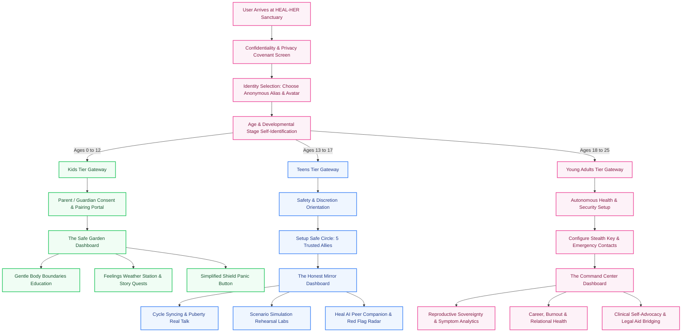
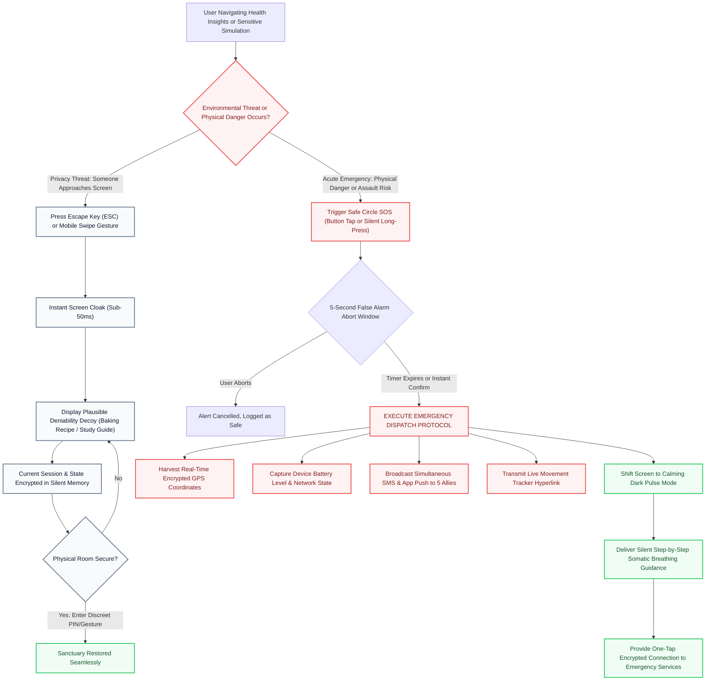

# 🌸 HEAL-HER: The Digital Sanctuary

> **An Intelligent Social-Health, Emotional Resilience, and Personal Safety Companion Engineered for Girls and Young Women Across Every Stage of Life.**

---

## 🌟 The Vision: A Promise to Every Girl

Growing up should never feel like navigating an emotional minefield in total isolation. From the moment a child begins to perceive the world around her, through the turbulent, transformative storms of adolescence, and into the high-stakes autonomy of young adulthood, every female faces questions she feels unable to speak aloud. 

She navigates changes in her body that society still wraps in silence. She experiences subtle shifts in friendships, the quiet dread of online harassment, the paralyzing confusion of relationship boundaries, and the visceral fear of unsafe physical spaces. Too often, the tools available to her are cold, punitive, dismissive, or predatory—monetizing her attention, harvesting her personal vulnerabilities, or burying simple truths beneath clinical jargon and cultural taboo.

**HEAL-HER was created to rewrite this narrative entirely.**

HEAL-HER is not merely an application; it is an intelligent digital sanctuary—a private, warm, and vigilant companion designed to stand beside girls and young women as they grow. By seamlessly blending radical empathy, age-tailored emotional intelligence, situational simulation training, and life-saving safety mechanisms, HEAL-HER ensures that no girl ever has to face confusion alone, feel ashamed of her natural biology, or remain unprotected when danger looms.

---

## 📑 Table of Contents

- [🌸 HEAL-HER: The Digital Sanctuary](#-heal-her-the-digital-sanctuary)
  - [🌟 The Vision: A Promise to Every Girl](#-the-vision-a-promise-to-every-girl)
  - [📑 Table of Contents](#-table-of-contents)
  - [📖 The Story & Mission (The 'Why')](#-the-story--mission-the-why)
    - [The Anatomy of a Modern Crisis](#the-anatomy-of-a-modern-crisis)
    - [The Algorithmic Trap and the Information Vacuum](#the-algorithmic-trap-and-the-information-vacuum)
    - [The Birth of the Digital Sanctuary](#the-birth-of-the-digital-sanctuary)
    - [The Four Pillars of the HEAL-HER Covenant](#the-four-pillars-of-the-heal-her-covenant)
  - [🌺 The Three Tiers (The 'Who')](#-the-three-tiers-the-who)
    - [Tier 1: Kids (Ages 0–12) — The Safe Garden of Wonder](#tier-1-kids-ages-012--the-safe-garden-of-wonder)
      - [Developmental Psychology & Experiential Tone](#developmental-psychology--experiential-tone)
      - [Foundational Boundary & Body Autonomy Education](#foundational-boundary--body-autonomy-education)
      - [Gamified Explorations & Sensory Comfort](#gamified-explorations--sensory-comfort)
      - [The Protective Walled Garden & Guardian Tether](#the-protective-walled-garden--guardian-tether)
    - [Tier 2: Teens (Ages 13–17) — The Honest Mirror & Compassionate Ally](#tier-2-teens-ages-1317--the-honest-mirror--compassionate-ally)
      - [Developmental Psychology & Experiential Tone](#developmental-psychology--experiential-tone-1)
      - [Demystifying Puberty, Menstruation, and Hormonal Waves](#demystifying-puberty-menstruation-and-hormonal-waves)
      - [Navigating the Social Wild: Peer Pressure, Red Flags, and Digital Health](#navigating-the-social-wild-peer-pressure-red-flags-and-digital-health)
      - [Interactive Behavioral Rehearsal Labs](#interactive-behavioral-rehearsal-labs)
    - [Tier 3: Young Adults (Ages 18–25) — The Autonomous Command Center](#tier-3-young-adults-ages-1825--the-autonomous-command-center)
      - [Developmental Psychology & Experiential Tone](#developmental-psychology--experiential-tone-2)
      - [Comprehensive Reproductive Literacy & Clinical Self-Advocacy](#comprehensive-reproductive-literacy--clinical-self-advocacy)
      - [Life Navigation: Burnout, Independence, and Relational Sovereignty](#life-navigation-burnout-independence-and-relational-sovereignty)
      - [Crisis Readiness, Legal Rights, and Professional Bridging](#crisis-readiness-legal-rights-and-professional-bridging)
  - [💡 Feature Deep Dives (The 'What')](#-feature-deep-dives-the-what)
    - [The AI Buddy: Adaptive Socio-Emotional Intelligence](#the-ai-buddy-adaptive-socio-emotional-intelligence)
      - [Tier-Dynamic Tone Morphing](#tier-dynamic-tone-morphing)
      - [Reflective Listening and Somatic Grounding](#reflective-listening-and-somatic-grounding)
      - [Uncompromising Safety Guardrails](#uncompromising-safety-guardrails)
    - [Stealth Mode (The Escape Key): Instant Tactical Camouflage](#stealth-mode-the-escape-key-instant-tactical-camouflage)
      - [The Physical Reality of Insecure Environments](#the-physical-reality-of-insecure-environments)
      - [Sub-50ms Optical Transformation](#sub-50ms-optical-transformation)
      - [Plausible Deniability Decoy Ecosystem](#plausible-deniability-decoy-ecosystem)
      - [Silent Memory Preservation & Secret Recovery](#silent-memory-preservation--secret-recovery)
    - [Safe Circle (SOS): The Rapid-Response Human Network](#safe-circle-sos-the-rapid-response-human-network)
      - [Architecting the Circle of Trust](#architecting-the-circle-of-trust)
      - [Multi-Vector Silent Distress Activation](#multi-vector-silent-distress-activation)
      - [Automated Dispatch & Live Coordinates](#automated-dispatch--live-coordinates)
      - [In-Crisis Grounding & Guided De-escalation](#in-crisis-grounding--guided-de-escalation)
    - [Scenario Simulations: The Experiential Rehearsal Lab](#scenario-simulations-the-experiential-rehearsal-lab)
      - [The Psychology of Visceral Muscle Memory](#the-psychology-of-visceral-muscle-memory)
      - [Branching Real-World Scenarios](#branching-real-world-scenarios)
      - [Non-Judgmental Reflection & Script Armory](#non-judgmental-reflection--script-armory)
  - [🗺️ The User Journey: System Flowcharts](#️-the-user-journey-system-flowcharts)
    - [Flowchart 1: Onboarding, Safety Orientation & Dynamic Tier Routing](#flowchart-1-onboarding-safety-orientation--dynamic-tier-routing)
    - [Flowchart 2: The Tactical Stealth Mode & SOS Emergency Dispatch Lifecycle](#flowchart-2-the-tactical-stealth-mode--sos-emergency-dispatch-lifecycle)
  - [🛡️ The Management Shell (The Principal Rail)](#️-the-management-shell-the-principal-rail)
    - [The Guardian's Watchtower](#the-guardians-watchtower)
    - [Privacy-by-Design vs. Duty of Care](#privacy-by-design-vs-duty-of-care)
    - [Educational Curation and Regional Helpline Mapping](#educational-curation-and-regional-helpline-mapping)
  - [🌈 The Horizon Ahead: A World Without Fear](#-the-horizon-ahead-a-world-without-fear)

---

## 📖 The Story & Mission (The 'Why')

### The Anatomy of a Modern Crisis

The world into which young girls are born today is vastly different from any era in human history. Digital connectivity has connected humanity across continents, yet it has paradoxically exacerbated childhood isolation, adolescent anxiety, and the vulnerability of young women.

From their earliest school years, young girls encounter subtle messages dictating how their bodies should appear, how their emotions should be curated, and how their boundaries should be relaxed to accommodate others. By the time puberty arrives, the challenge accelerates dramatically. Natural physiological milestones—menstruation, physical maturation, changing scents, fluctuating hormones—are all too frequently presented not as sacred biological superpowers, but as shameful secrets to be hidden behind locked bathroom doors.

When questions arise, who can a twelve-year-old ask? In many families, cultural taboos, religious shame, or parental discomfort silence healthy conversations before they can begin. In schools, health education curriculums are frequently outdated, overly clinical, hurried, or severed from real-world emotional realities. A girl wondering if her agonizing cramps are normal, or whether an older acquaintance's text message crosses an unacceptable line, finds herself trapped in a suffocating vacuum of silence.

### The Algorithmic Trap and the Information Vacuum

In the absence of trusted, confidential human channels, young women turn to the public internet. But the open web is an unforgiving landscape for vulnerable seekers:

1. **Commercial Exploitation**: Search engines direct inquiries toward advertising-driven portals designed to provoke terror, diagnose catastrophic illnesses from mild symptoms, or sell beauty products to fix imagined physical flaws.
2. **Algorithmic Radicalization**: Social media video feeds push toxic body comparisons, viral pseudo-scientific wellness trends, and predatory relationship paradigms that glorify emotional dependency and normalized abuse.
3. **The Loss of Privacy**: Asking a question on a public forum or social network leaves permanent digital footprints, exposing adolescent seekers to mockery, cyberbullying, doxxing, or targeted digital predators.

A young woman should never have to gamble her safety, her mental peace, or her dignity simply to understand her own body or learn how to safeguard her boundaries.

### The Birth of the Digital Sanctuary

HEAL-HER was conceived out of an urgent, non-negotiable moral imperative: to build a protected digital sanctuary that honors the innocence of childhood, equips the vulnerability of adolescence, and champions the sovereign autonomy of young adulthood.

We envisioned a space that feels like the wisest, warmest older sister imaginable—an entity that never judges, never scolds, never betrays a confidence, and never sleeps. A companion that meets every user exactly where she is developmentally, speaking her language without talking down to her, validating her fears while giving her practical, actionable courage.

HEAL-HER does not preach; it empowers. It does not dictate; it guides. It is a warm, unshakeable ally standing between young women and the chaos of an uninformed world.

### The Four Pillars of the HEAL-HER Covenant

Every experience, interaction, and safeguard within HEAL-HER is anchored in four sacred principles:

1. **Radical Empathy**: We believe that feelings are data. Anxiety, shame, curiosity, and anger are not flaws to be corrected; they are signals to be understood. HEAL-HER responds to emotional distress with immediate warmth and somatic validation before offering logical solutions.
2. **Uncompromising Confidentiality**: A sanctuary cannot exist without total safety. Every question asked, every symptom logged, and every simulation completed belongs solely to the user. We uphold the sacred trust of every young person who seeks shelter here.
3. **Developmental Adaptation**: One size fits none. What comforts an eight-year-old will alienate a sixteen-year-old, and what guides an adolescent will bore a university senior. HEAL-HER evolves alongside the user, adapting its tone, vocabulary, depth, and safety guardrails across distinct developmental tiers.
4. **Vigilant Protection**: Compassion without defense is insufficient. HEAL-HER integrates instant physical-environment camouflage (Stealth Mode) and rapid emergency dispatch systems (Safe Circle SOS) to protect our users in the real, physical world when their personal safety is compromised.

---

## 🌺 The Three Tiers (The 'Who')

Human development is not a light switch; it is a gradual, profound metamorphosis. To serve girls authentically, HEAL-HER partitions its user experience into three deeply researched, developmentally specialized tiers.

```
                      ┌────────────────────────────────────────┐
                      │          HEAL-HER PLATFORM             │
                      └──────────────────┬─────────────────────┘
                                         │
         ┌───────────────────────────────┼───────────────────────────────┐
         │                               │                               │
         ▼                               ▼                               ▼
  🌿 KIDS TIER                     🌸 TEENS TIER                 🌟 YOUNG ADULTS TIER
   (Ages 0–12)                     (Ages 13–17)                      (Ages 18–25)
  ─────────────────               ─────────────────             ──────────────────────
  • Safe Garden UI                • Honest Mirror UI            • Command Center UI
  • Gentle Storytelling           • Puberty & Cycle Real Talk   • Reproductive Sovereignty
  • Body Boundary Basics          • Relationship Red Flags      • Career & Life Autonomy
  • Gamified Quests               • Scenario Rehearsal Labs     • Advanced Health Tracking
  • Walled Moderation             • Peer-Level Safe Circle      • Clinical Self-Advocacy
```

---

### Tier 1: Kids (Ages 0–12) — The Safe Garden of Wonder

#### Developmental Psychology & Experiential Tone
In the earliest chapter of life, a child's concept of the world is formed through sensory comfort, wonder, and clear, protective boundaries. The Kids Tier is styled as a luminous, enchanting garden populated by friendly animal companions, soft pastel palettes, calming natural ambient sounds, and uplifting, joyful affirmations. 

The tone is endlessly gentle, patient, and warm. Words are chosen with meticulous care to inspire self-worth and curious exploration without introducing adult concepts, anxieties, or premature complexities. The environment feels like a cozy reading nook where a child can rest, play, and ask questions without fear of getting in trouble.

#### Foundational Boundary & Body Autonomy Education
Education in this tier is built around the fundamental truth that every child's body belongs entirely to herself. HEAL-HER gently introduces children to the vocabulary of personal autonomy:
- **The Swimsuit Rule**: Clear, non-scary guidance on parts of the body that are private, teaching children that no one has the right to touch those areas, nor should anyone ask a child to touch theirs or keep secrets about touch.
- **The Body Alarm System**: Teaching children to recognize their body's instinctual warning lights—the fluttery tummy, the sweaty palms, the racing heart—and empowering them to trust those feelings when something feels weird, confusing, or unsafe.
- **Naming the Emotional Spectrum**: Beyond just "happy" or "sad," children are helped to identify nuanced feelings such as feeling left out, feeling overwhelmed by noise, feeling nervous about school, or feeling jealous of a sibling.

#### Gamified Explorations & Sensory Comfort
Children absorb knowledge best through storytelling and play. The Kids Tier transforms safety education into delightful, bite-sized quests:
- **The Feelings Weather Station**: An interactive visual mood tracker where children can paint their current day as a gentle sunrise, a thunderstorm, a cloudy sky, or a rainbow, unlocking supportive bedtime stories tailored to their emotional climate.
- **Interactive Audio Escapes**: Calming breath exercises where friendly illustrated characters guide children to blow out imaginary birthday candles or breathe in like smelling a sweet flower, teaching early emotional regulation.
- **Story Quests of the Brave Explorer**: Illustrated narratives featuring young heroines who learn how to speak up when someone takes their toy, how to tell a teacher when a game turns mean, and how to say a firm, polite "No!" when they do not want a hug.

#### The Protective Walled Garden & Guardian Tether
The Kids Tier operates within an impervious protective perimeter. There are no public message boards, no direct messaging channels with strangers, and no algorithmic feeds. The AI Buddy operates with the strictest possible guardrails: if a child expresses indicators of neglect, physical harm, or severe distress, the system immediately wraps the child in comforting, de-escalating dialogue while calmly alerting designated guardians through the administrative rail.

---

### Tier 2: Teens (Ages 13–17) — The Honest Mirror & Compassionate Ally

#### Developmental Psychology & Experiential Tone
Adolescence is a crucible. As teenage girls navigate the seismic physical, hormonal, and psychological shifts of high school, their primary need shifts from childlike comfort to authentic validation. Teens can spot condescension or lecturing in a microsecond; they reject preachiness and crave honest, unfiltered truth delivered with mutual respect.

The Teens Tier reflects a vibrant, contemporary, and deeply empathetic tone. The aesthetic is clean, modern, expressive, and energizing, utilizing sleek dark-mode accents, warm glowing gradients, and dynamic visual widgets that mirror the polish of modern applications while retaining an intimate diary-like warmth.

#### Demystifying Puberty, Menstruation, and Hormonal Waves
HEAL-HER demystifies the biological revolution occurring inside an adolescent's body without stigma or embarrassment:
- **Cycle Syncing & Hormonal Literacy**: Moving far beyond a mere calendar date tracker, HEAL-HER explains the four distinct phases of the menstrual cycle (follicular, ovulatory, luteal, and menstrual). It teaches young women why their energy peaks on certain weeks, why brain fog or emotional sensitivity might arrive before their period, and how nutrition and rest can harmonize with these natural rhythms.
- **The Myth-Buster Vault**: Frank, medically accurate answers to questions teens are too embarrassed to ask their peers: vaginal discharge variations, breast development asymmetry, body hair, acne management, and toxic hygiene myths pushed by commercial brands.
- **Cramp Relief & Somatic Care**: Practical, immediate non-pharmacological relief protocols—acupressure techniques, warm tea suggestions, gentle restorative yoga poses, and soothing soundscapes designed to calm uterine spasms.

#### Navigating the Social Wild: Peer Pressure, Red Flags, and Digital Health
The digital world presents teenage girls with unprecedented relational minefields. HEAL-HER acts as a trusted compass:
- **The Red Flag Radar**: An analytical self-assessment tool helping teens evaluate romantic interests, friendships, and group dynamics. Does a boyfriend demand passwords to her accounts? Does a friend gossip behind her back while demanding absolute loyalty? The tool provides clarity, helping users differentiate between healthy affection, possessiveness, and emotional manipulation.
- **Digital Footprint & Anti-Sextortion Guidance**: Clear, non-judgmental education on digital boundaries. It equips young women with strategies to handle coercive photo requests, online rumors, group chat bullying, and predatory older individuals on social platforms.
- **Burnout & Social Media Detox Protocols**: Guiding young women to recognize when algorithmic feeds are corroding their self-image or fueling body dysmorphia, with structured digital pause rituals.

#### Interactive Behavioral Rehearsal Labs
Teens do not learn boundary setting by reading passive articles; they learn by doing. The Teens Tier features rich, gamified simulation labs where users step into interactive scenarios:
- How to decline an alcoholic drink or vape at a high school party without feeling like an outcast.
- How to establish physical boundaries on a first date with firm, graceful assertiveness.
- How to confront a close friend who has shared a personal secret without escalating into mutual destruction.

---

### Tier 3: Young Adults (Ages 18–25) — The Autonomous Command Center

#### Developmental Psychology & Experiential Tone
Stepping into young adulthood brings legal independence, university challenges, career entry, independent living, and complex intimate relationships. Young women in this stage are no longer seeking permission; they are claiming their sovereignty. They need an intelligent, high-utility, confidential command center that treats them as autonomous architects of their own destiny.

The Young Adults Tier features a minimalist, sophisticated, and empowering design language. It integrates comprehensive health diagnostics, career wellness analytics, mental health resilience tracking, and rapid tactical security tools into a streamlined, mature user interface that commands respect.

#### Comprehensive Reproductive Literacy & Clinical Self-Advocacy
In the modern world, navigating healthcare systems can be intimidating, dismissive, and bewildering. HEAL-HER equips young women to be unstoppable self-advocates:
- **Sovereign Health Tracking**: Longitudinal tracking of symptoms, ovulation windows, basal temperature variations, mood trajectories, and cycle anomalies, generating structured symptom summaries that users can hand directly to their gynecologists.
- **Contraceptive & Reproductive Education**: Deep, non-judgmental encyclopedias detailing all contraceptive methodologies (hormonal, non-hormonal, barrier, fertility awareness), exploring side effects, mechanism of action, and questions to ask before selecting a method.
- **Navigating Clinical Gaslighting**: Equipping women with assertive verbal scripts when medical practitioners dismiss chronic pelvic pain, endometriosis symptoms, PCOS indicators, or severe mental health shifts as "just stress" or "normal cramps."

#### Life Navigation: Burnout, Independence, and Relational Sovereignty
Young adulthood is often marked by acute transitions—moving away from family, entering hostile or male-dominated workplace environments, managing personal finances, and dating in a modern world characterized by casual detachment:
- **Workplace Boundary Shield**: Advice and strategies for navigating corporate micro-aggressions, salary negotiations, workplace sexual harassment, and establishing firm work-life separation.
- **Intimate Partner Dynamics & Toxic Relationship Disengagement**: Advanced relationship safety analysis, identifying covert narcissism, financial abuse, trauma bonding, and step-by-step guidance for safely leaving high-control or physically intimidating domestic environments.
- **Financial Autonomy & Wellness**: Connecting physical health with financial independence, recognizing that financial dependency is often the single greatest barrier preventing women from leaving dangerous environments.

#### Crisis Readiness, Legal Rights, and Professional Bridging
For young adults living independently, safety is an immediate, practical concern:
- **Campus & Commute Safety**: Late-night transit tracking protocols, walking companionships, and one-tap local emergency dispatch.
- **Legal Rights Literacy**: Knowing one's rights regarding tenant safety, domestic protection orders, workplace harassment reporting, and medical consent laws.
- **Direct Hotlines & Verified Professional Networks**: Instantaneous, encrypted connections to certified mental health therapists, crisis hotlines, domestic violence shelters, and free legal aid networks.

---

## 💡 Feature Deep Dives (The 'What')

The HEAL-HER platform is powered by four groundbreaking proprietary innovations that bridge the gap between emotional companionship and life-saving physical security.

```
       ┌────────────────────────────────────────────────────────┐
       │                CORE PLATFORM INNOVATIONS               │
       └───────────────────────────┬────────────────────────────┘
                                   │
      ┌──────────────────┬─────────┴────────┬──────────────────┐
      ▼                  ▼                  ▼                  ▼
  🤖 AI BUDDY       🕶️ STEALTH MODE     🆘 SAFE CIRCLE    🎭 SIMULATION LABS
  Adaptive Tone &    Instant Tactical    Multi-Vector       Interactive Social
  Emotional Intel    Camouflage Screen   Emergency SOS      Rehearsal Engines
```

---

### The AI Buddy: Adaptive Socio-Emotional Intelligence

The central nervous system of HEAL-HER is the **AI Buddy** (in the Kids Tier) and **Heal AI** (in the Teens and Young Adult Tiers). Unlike generic, robotic search assistants or unvetted commercial chatbots, this companion is trained fundamentally on the tenets of developmental psychology, trauma-informed care, and non-violent communication.

#### Tier-Dynamic Tone Morphing
The companion changes its conversational cadence, intellectual depth, and metaphorical framing based on the active user’s demographic profile:
- **For an 8-Year-Old**: "Hello, little explorer! 🌸 Did your feelings feel like a warm sunny day today, or did a little storm cloud blow into your heart? Remember, even the biggest thunderstorms run out of rain. I'm right here with you!"
- **For a 15-Year-Old**: "Hey there. I hear how exhausting that argument with Sarah was. It hurts when someone you’ve shared everything with acts like you don't exist. Take a breath—you don’t have to figure it all out tonight. Want to unpack what she said, or do you just need to vent without any advice?"
- **For a 22-Year-Old**: "Welcome back. Navigating this performance review while dealing with severe luteal-phase exhaustion is a profound physical challenge. Let's look at the symptoms you logged over the past four days, craft a clear agenda for your meeting, and set a hard boundary for your evening rest."

#### Reflective Listening and Somatic Grounding
The AI Buddy never dismisses an emotion. When a user logs an entry such as *"I hate my body today, I look disgusting in everything,"* a standard assistant might recite generic body-positive quotes. The AI Buddy, however, practices deep somatic validation:
1. **Name and Acknowledge**: *"I hear how heavy and frustrating today feels. Looking in the mirror and feeling at war with yourself is an exhausting sensation."*
2. **De-escalate the Cognitive Spiral**: *"Let's take a pause before believing everything that critical voice is whispering. Your body worked hard just to breathe, walk, and carry you through this day."*
3. **Offer an Interactive Somatic Anchor**: *"Can you unclamp your jaw for me? Drop your shoulders two inches away from your ears. Let's do a three-breath reset together right now."*

#### Uncompromising Safety Guardrails
The companion maintains active, silent sentinel algorithms. If any conversational input indicates self-harm, eating disorder behavior, physical assault, or severe abuse:
- The AI immediately shifts from casual conversation into an ultra-supportive, de-escalating safety protocol.
- It provides immediate, warm, clear pathways to human help (crisis text lines, trusted contacts).
- It never shames, interrogates, or threatens the user, maintaining the sanctuary's integrity at all times.

---

### Stealth Mode (The Escape Key): Instant Tactical Camouflage

One of the most profound innovations within HEAL-HER is **Stealth Mode**, colloquially known as **The Escape Key**.

```
    [COMPROMISED ENVIRONMENT DETECTED] ──> PRESS [ESC] KEY / DISCREET GESTURE
                                                        │
                                                        ▼
                                       ┌──────────────────────────────────┐
                                       │   SUB-50ms IMMEDIATE BLINDING    │
                                       │    All chat & SOS UI vanished    │
                                       └────────────────┬─────────────────┘
                                                        │
                                                        ▼
                                       ┌──────────────────────────────────┐
                                       │     PLAUSIBLE DENIABILITY DECOY  │
                                       │   "Baking Recipe / Study Guide"  │
                                       └──────────────────────────────────┘
```

#### The Physical Reality of Insecure Environments
Many young women live in households, dormitories, or relationships where personal privacy does not exist. An abusive partner walking into the bedroom, an overbearing parent opening the door without knocking, or an inquisitive classmate peering over a shoulder on the bus can turn a moment of private health research into an immediate physical or emotional confrontation.

If a girl is reading about birth control, learning how to exit a toxic relationship, or preparing an SOS alert, she cannot afford to spend three seconds clicking through tabs or closing a window. She needs immediate, plausible camouflage.

#### Sub-50ms Optical Transformation
By simply tapping the **`Escape` (`Esc`) key** on any keyboard, or performing a discreet multi-finger swipe on mobile screens:
- The entire HEAL-HER interface vanishes in under 50 milliseconds.
- No health metrics, no chat bubbles, no SOS buttons, and no color palettes remain visible to the human eye.

#### Plausible Deniability Decoy Ecosystem
Unlike crude privacy tools that simply minimize a window (which in itself arouses immediate suspicion: *"What are you hiding? Open that back up!"*), HEAL-HER instantly replaces the screen with an authentic, interactive, and completely mundane decoy screen:
- **The Culinary Recipe Hub**: An interactive recipe card for chocolate chip cookies or berry smoothies, complete with ingredient sliders, prep times, and cooking instructions.
- **The Academic Study Guide**: A textbook-style summary of classic literature or biology flashcards, looking exactly like standard school homework.
- **The Daily Weather & News Digest**: A clean, unremarkable daily planner showing local weather forecasts and generic lifestyle articles.

Anyone looking at the screen sees a focused student or a hobbyist reading a recipe. The user is instantly shielded from suspicion.

#### Silent Memory Preservation & Secret Recovery
While the screen displays a cookie recipe, the user's active session is not destroyed. Her typed draft, her conversation with the AI Buddy, or her active scenario simulation is preserved in a secure, encrypted memory vault. When the physical threat has walked away and the room is secure, the user enters her discreet personal gesture or PIN, and the sanctuary reappears instantly, precisely where she left off.

---

### Safe Circle (SOS): The Rapid-Response Human Network

Emergency safety cannot rely exclusively on automated systems. When a young woman is in acute danger—being followed down a dark street, trapped in an escalating domestic confrontation, or experiencing a severe physical medical emergency—she needs her trusted human tribe activated instantly.

```
                  ┌─────────────────────────────────────────┐
                  │       SAFE CIRCLE: 5 TRUSTED ALLIES     │
                  └────────────────────┬────────────────────┘
                                       │
                      [PANIC BUTTON TRIGGERED / SILENT HOLD]
                                       │
                    ┌──────────────────┴──────────────────┐
                    ▼                                     ▼
        ┌───────────────────────┐             ┌───────────────────────┐
        │ 5-SECOND ABORT WINDOW │             │ INSTANT SILENT DISPATCH│
        │ Prevents false alarms │             │ Real-Time GPS Stream  │
        └───────────────────────┘             │ Battery Level Sent    │
                                              │ Distress SMS / Voice  │
                                              └───────────────────────┘
```

#### Architecting the Circle of Trust
Every user is guided through the deliberate, thoughtful assembly of her **Safe Circle**—a curated council of up to five trusted individuals:
- **In the Kids Tier**: The circle is configured in collaboration with parents, guardians, grandparents, or designated school counselors.
- **In the Teens Tier**: The circle often pairs trusted family members with a reliable older sibling, mentor, or lifelong friend.
- **In the Young Adults Tier**: The circle empowers women to designate trusted roommates, life partners, trusted colleagues, or local community emergency services.

#### Multi-Vector Silent Distress Activation
In a moment of acute danger, an individual rarely has the luxury of making a phone call:
1. **The Big Red Shield**: A prominent, tactile SOS button within the application dashboard.
2. **The Silent Long-Press**: For high-threat scenarios, holding the screen for three seconds initiates a silent trigger that does not beep, vibrate, or flash, keeping the phone completely dark or disguised while dispatching help.
3. **The 5-Second Cancellation Window**: To prevent accidental panic alarms, a gentle countdown clock allows immediate cancellation with a single tap if a button was touched in error.

#### Automated Dispatch & Live Coordinates
Once triggered, the Safe Circle engine immediately dispatches simultaneous multi-channel alerts to all five trusted contacts:
- An urgent SMS and push notification: *"URGENT: [User Name] has triggered her HEAL-HER Safe Circle SOS and may need immediate assistance."*
- A live, encrypted hyperlink displaying her real-time physical GPS coordinates, updating as she moves.
- Her current device battery level, so contacts know if her phone is about to power off.
- Quick-dial buttons for local emergency response services (police, medical, transit security).

#### In-Crisis Grounding & Guided De-escalation
While the alert is en route, the user's screen does not leave her stranded in panic. It shifts to a calming, dark-mode pulse that whispers grounding instructions:
- *"Your circle has been alerted. Your location has been shared. Help is on the way."*
- *"Keep your back against the wall. Keep your phone low."*
- *"Inhale as the circle expands... Exhale as it contracts..."*

---

### Scenario Simulations: The Experiential Rehearsal Lab

Traditional safety education fails because of a biological reality: **under acute stress, the prefrontal cortex shuts down and the amygdala takes over.** 

A young girl can read fifty pamphlets about "saying no to strangers" or "spotting bad boyfriends," but when an older boy corners her at a party or an aggressive adult demands compliance, adrenaline surges. Without prior experiential practice, she freezes.

HEAL-HER solves this through the **Scenario Simulation Lab**—an interactive, gamified behavioral simulator.

```
       ┌────────────────────────────────────────────────────────┐
       │             SCENARIO SIMULATION LAB ENGINES            │
       └───────────────────────────┬────────────────────────────┘
                                   │
       ┌───────────────────────────┼───────────────────────────┐
       ▼                           ▼                           ▼
  [THE HIGH SCHOOL PARTY]     [THE COERCIVE TEXT]      [THE DORMITORY BOUNDARY]
  Navigating drink offers     Handling pressure for    Confronting an invasive
  and unwanted physical       intimate photos or       roommate with firm,
  proximity without shame     social media passwords   dignified assertiveness
```

#### The Psychology of Visceral Muscle Memory
Simulations allow young women to experience the emotional tension of difficult social encounters in a safe, zero-consequence digital sandbox. By reading authentic dialogue, feeling the internal hesitation, and actively selecting how to respond, users build cognitive pathways and emotional muscle memory. When the situation arises in real life, their minds do not freeze—they recognize the pattern and deploy the trained response.

#### Branching Real-World Scenarios
Each simulation is structured as a rich, multi-branching decision tree created in collaboration with adolescent psychologists:
- **Scenario A: "The Coercive DM"**: An acquaintance from school sends a message asking for a private photo, following up with guilt-tripping: *"If you really trusted me, you'd send it. Everyone else does."*
  - *Option 1 (Appeasement)*: The user sees how trying to appease a boundary-crosser only invites greater pressure.
  - *Option 2 (Aggressive Counter)*: The user experiences how escalating anger can trigger retaliatory online rumors.
  - *Option 3 (Firm Boundary Script)*: The user practices delivering a calm, ironclad refusal that shuts down the manipulation immediately, backed by tools to block and report.
- **Scenario B: "The Red Flag Ride"**: A driver who offered a ride home begins making inappropriate comments and taking a route unfamiliar to the user. The simulation trains the user on how to pretend an urgent phone call, demand to be let out at a brightly lit gas station, and immediately trigger her Safe Circle.

#### Non-Judgmental Reflection & Script Armory
At the conclusion of each simulation, HEAL-HER does not issue letter grades or scold mistakes. Instead, it provides a warm, insightful debrief:
- **The Psychology Breakdown**: Why did the antagonist's words feel hard to say no to? What emotional buttons were being pushed?
- **Green Flags vs. Red Flags**: Highlighting the subtle cues that signaled manipulation before it became obvious.
- **The Script Armory**: Providing exact, memorable, ready-to-speak phrases that the user can store in her mental toolkit: *"I don't like how this feels, and I am leaving now."*

---

## 🗺️ The User Journey: System Flowcharts

To illustrate the holistic, deeply integrated nature of the platform, the following visual flowcharts map out the two most critical pathways within the HEAL-HER ecosystem.

---

### Flowchart 1: Onboarding, Safety Orientation & Dynamic Tier Routing

This diagram traces how a new user enters the digital sanctuary, selects her identity protections, completes her developmental assessment, and is routed into her dedicated tier ecosystem.



---

### Flowchart 2: The Tactical Stealth Mode & SOS Emergency Dispatch Lifecycle

This diagram illustrates the immediate, dual-layer protection matrix that activates when a user encounters either a privacy breach in her immediate physical space or an acute emergency.



---

## 🛡️ The Management Shell (The Principal Rail)

Behind every sanctuary, there must exist trusted sentinels. The **Management Shell**, affectionately referred to within the architecture as **The Principal Rail**, represents the administrative and pastoral backbone of the HEAL-HER platform.

```
       ┌────────────────────────────────────────────────────────┐
       │             THE MANAGEMENT SHELL (PRINCIPAL RAIL)      │
       └───────────────────────────┬────────────────────────────┘
                                   │
      ┌────────────────────────────┼────────────────────────────┐
      ▼                            ▼                            ▼
  👁️ GUARDIAN WATCHTOWER      ⚖️ PRIVACY-BY-DESIGN         📚 CURRICULUM GOVERNANCE
  High-Altitude Telemetry      Zero Surveillance of         Regional Crisis Mappings
  & Severe Crisis Alerts       Personal Chat Journals       & Evidence-Based Content
```

### The Guardian's Watchtower
The Principal Rail is designed for authorized institutional custodians—school principals, licensed educational psychologists, designated child protection officers, and platform wellness directors. It provides a dignified, high-altitude operational watchtower over the community:
- **Systemic Health Indicators**: Aggregated, fully anonymized trend analytics that reveal the pulse of the community. Are ninth-graders experiencing an unprecedented spike in anxiety related to exam season? Has there been a cluster of cyberbullying reports originating from a specific regional zone?
- **Urgent Incident Dispatch Stream**: When a user's SOS trigger is deployed or when an AI conversation flags critical markers of domestic abuse or suicidal ideation, the Principal Rail highlights the alert in high-priority crimson, displaying actionable dispatch data and verifying that human emergency contacts have received notification.

### Privacy-by-Design vs. Duty of Care
The defining ethical triumph of the Management Shell is its uncompromising balance between **guardian vigilance** and **individual privacy**. 

In conventional parental monitoring software, guardians are given invasive keystroke-logging access to read every text message and private thought their children generate. This surveillance destroys trust; children immediately abandon monitored platforms and seek unmonitored, unsafe dark corners of the web.

HEAL-HER rejects this surveillance model entirely:
- **No Keystroke Logging**: Guardians, school staff, and counselors **cannot** read a young woman's intimate diary entries, her exploratory questions about biology, or her personal conversations with the AI Buddy.
- **The Anonymized Sentinel**: The system uses automated safety classifiers that evaluate risk severity at the edge. Only when an unequivocal crisis threshold is breached (imminent physical violence, self-harm, or child exploitation) does the system escalate an emergency ticket—providing guardians with the critical safety context necessary to preserve life, while leaving the user's dignity intact.

### Educational Curation and Regional Helpline Mapping
The Principal Rail also serves as the platform’s pedagogical workshop:
- **Clinical Content Verification**: Medical professionals, adolescent health specialists, and counselors continuously review, update, and certify every scenario simulation and health explainer.
- **Dynamic Regional Resource Routing**: A user in Nairobi, a student in London, and a teenager in Toronto require radically different crisis hotlines, domestic shelters, and local legal aid resources. The Management Shell dynamically manages and verifies geographic directory listings, ensuring that when an SOS is triggered, help is real, proximate, and culturally competent.

---

## 🌈 The Horizon Ahead: A World Without Fear

At its core, HEAL-HER is an act of defiance against a world that has, for too many centuries, demanded that young women navigate their most tender vulnerabilities alone.

We believe in a future where:
- No twelve-year-old girl ever stares at her first menstrual blood in terror, wondering if she is dying.
- No fourteen-year-old girl ever feels pressured into surrendering her bodily boundaries just to feel loved or accepted.
- No eighteen-year-old woman ever walks through the night with keys laced between her knuckles without an invisible circle of allies walking with her.
- No young woman ever feels silenced, dismissed, or shamed by healthcare providers or society for speaking the truth of her experience.

HEAL-HER is the digital hearth where curiosity is answered with science, fear is met with fierce tenderness, and vulnerability is crowned with unshakeable strength.

**To every girl who has ever felt unseen, frightened, or alone: welcome home. You are safe here.**

---

*“When we heal a girl, we heal a mother, a leader, a community, and a generation.”*  
**— The HEAL-HER Initiative**
